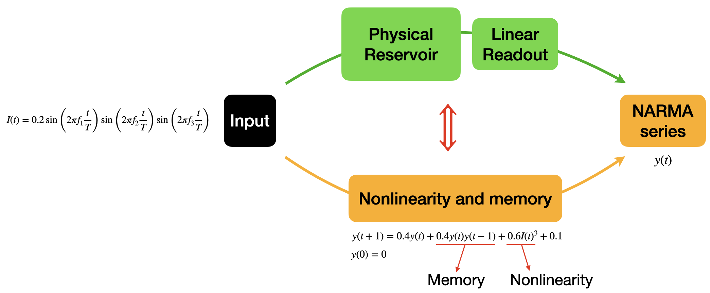
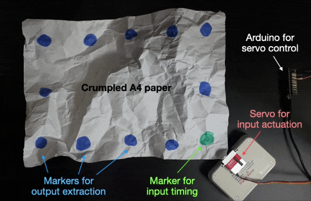
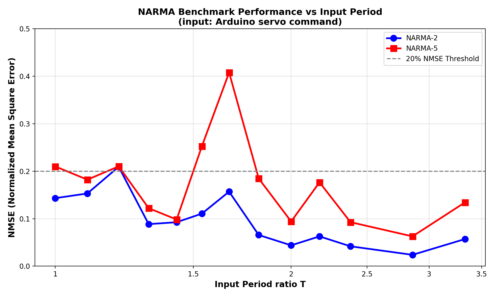

# Physical Reservoir Computing Examples

This repository contains examples of Physical Reservoir Computing (PRC) systems suitable for PHRESCO 2026 competition submissions. We are preparing multiple examples that will be updated gradually. All examples use the NARMA2 (Nonlinear Auto-Regressive Moving Average) test as a benchmark to evaluate the computational capabilities of the physical reservoirs.

## Overview: Physical Reservoir Computing Pipeline

The general pipeline for physical reservoir computing consists of:

1. **Input Signal**: A time-varying signal that drives the physical system. In PHRESCO we use a multi-frequency sinusoidal:
$I(t) = 0.2 \sin\left(\tfrac{2\pi f_{1} t}{T}\right)\sin\left(\tfrac{2\pi f_{2} t}{T}\right)\sin\left(\tfrac{2\pi f_{3} t}{T}\right)$,
where $f_{1}=2.11\,\text{Hz}$, $f_{2}=3.73\,\text{Hz}$, $f_{3}=4.33\,\text{Hz}$, and the parameter $T$ controls the phase velocity. **$I(t)$ is the signal you command**, for example the value your controller sends to the actuator. It is not a measurement taken on the actuator or on the body (see below). Its amplitude and offset may be scaled to suit your actuator, since the NARMA input is rescaled to $[0, 0.5]$ anyway.
2. **Target Output**: NARMA series generated from the input signal using a function. For NARMA2, the function is:
$y(t+1)=0.4y(t)+0.4y(t)y(t-1)+0.6I(t)^{3}+0.1$.
For NARMA-n, the function is:
$y(t+1)=\alpha y(t)+\beta y(t)\left(\sum_{j=0}^{n-1} y(t-j)\right)+\gamma I(t-n+1)I(t)+\delta$,
where $\alpha=0.3$, $\beta=0.05$, $\gamma=1.5$, $\delta=0.1$. Those equations generate target NARMA series from the initial state of $y(0)=0$, which introduces memory and nonlinearity.
4. **Physical Reservoir** 
5. **Linear Readout**: A trained linear layer that maps reservoir states to the target output.

If a physical reservoir passes the NARMA test—i.e., the linear readout can produce the target output when the reservoir is driven by the input signal—this means the reservoir-readout system processes the input signal in the same way as the NARMA equation. Since the NARMA equation introduces memory and nonlinearity, the reservoir-readout system must also exhibit the same memory and nonlinearity. Because the linear readout itself has no memory or nonlinearity, these must arise from the physical reservoir. Therefore, passing the NARMA test demonstrates that the physicial reservoir possesses memory and nonlinearity.

In PHRESCO, we require all participants to use the input signal described above. A reservoir qualifies for submission if it achieves a Normalised Mean Square Error (NMSE) below 20%.

**Use the commanded signal as the NARMA input.** Everything between the signal you command and the states you read out counts as the reservoir: the actuator's own dynamics (response time, speed and torque limits, backlash), the coupling between actuator and body (gripping, slipping, buckling, the body pushing back), and the body itself. If you build the NARMA target from a sensor reading of the actuator or of a point on the body, part of that physics is moved to the input side and is no longer tested. Log the command you send together with time stamps, and a sync event your sensors also see (for example an LED in view of the camera when the signal starts), so that input and states can be aligned. If you allow a fixed delay between input and readout, state it and choose it before looking at the test data.

The input signal and NARMA equation are adapted from Nakajima, Kohei, et al. "Information processing via physical soft body." Scientific reports 5.1 (2015): 10487.

## Example 1: Crumpled Paper Reservoir

### Overview

This example demonstrates one of the easiest possible physical reservoir computing systems that can qualify as a PHRESCO submission. 

**Experimental Setup:**
- **Reservoir**: A standard A4 paper, crumpled and then partially flattened, fixed at its centre point.
- **Input Actuation**: Servo motor (EMAX ES9256) providing angular displacement following the input signal, driven by an Arduino running `Crumpled_paper.ino`, which writes a pulse of $800 + \lfloor 700\,(\mathrm{sig}(t)+1) \rfloor\ \mu s$ every 5 ms, with $\mathrm{sig}(t)=\sin(2\pi f_1 m t)\sin(2\pi f_2 m t)\sin(2\pi f_3 m t)$ and $m = 1/T$. **The input used in the NARMA test is this commanded pulse width.** (`Arduino_crumpled_paper.ino` is a tidied version of the same sketch with a 20 ms update step; it was not used for the recordings here.)
- **Synchronisation**: these recordings did not log the Arduino clock, so the time of the first video frame on the Arduino clock was recovered once per video by fitting the command to the green marker's motion (only a start time and a clock-rate factor; fit R² 0.86 to 0.99). The results are in `servo_command_sync.json`. The green marker is used **only for this timing**, never as the NARMA input. In an earlier version of this example, the NARMA input was the green marker's position. That left the servo dynamics and the servo/paper coupling outside the reservoir, so it was changed in Nov 2026.
- **Output Extraction**: 22 reservoir state variables (X and Y positions of the 11 blue markers) tracked by camera.

### Data Processing Pipeline

1. **Video Tracking** (`CP_video_processing.m`):
   - Extract the green marker (used for timing only) and the reservoir states from video (60 fps)
   - Saves to MAT file with 60 Hz sampling rate (an example is given as `motion_tracking_50_3freq.mat`; all recordings used for the results are in `data/`)

2. **NARMA Benchmark** (`CrumpledPaper.m`, or `python/crumpled_paper_narma.py`):
   - Loads tracking data
   - Rebuilds the commanded servo pulse width at every video frame (formula above, timing from `servo_command_sync.json`)
   - Generates the NARMA target series from that command
   - Trains linear readout using least squares (80% train, 20% test, after a 20% washout)
   - Evaluates Normalized Mean Square Error (NMSE)
   - Visualise the results

   Python: `python python/crumpled_paper_narma.py [file.mat] [--order 5]` (needs numpy, scipy, matplotlib). `--input marker` reproduces the old definition for comparison. `python/make_result_figure.py` recreates the figure below, and `python/compare_input_sources.py` compares the old and new input definitions on every recording.

### Results

We tested the system at different period ratios T (applied simultaneously to the three base input frequencies) from 1 to 3.3, with both NARMA2 and NARMA5 benchmarks:

Since the reservoir achieves an NMSE below 20% in the NARMA2 test at almost all actuation frequencies, it qualifies for PHRESCO submission. Two limits of these legacy recordings: the delay between command and paper motion cannot be measured without a logged Arduino clock, and at 60 fps the NMSE is sensitive to a shift of a frame or two. The direction convention (which way the servo turns for a positive command) was set from the video and not measured on the rig.
